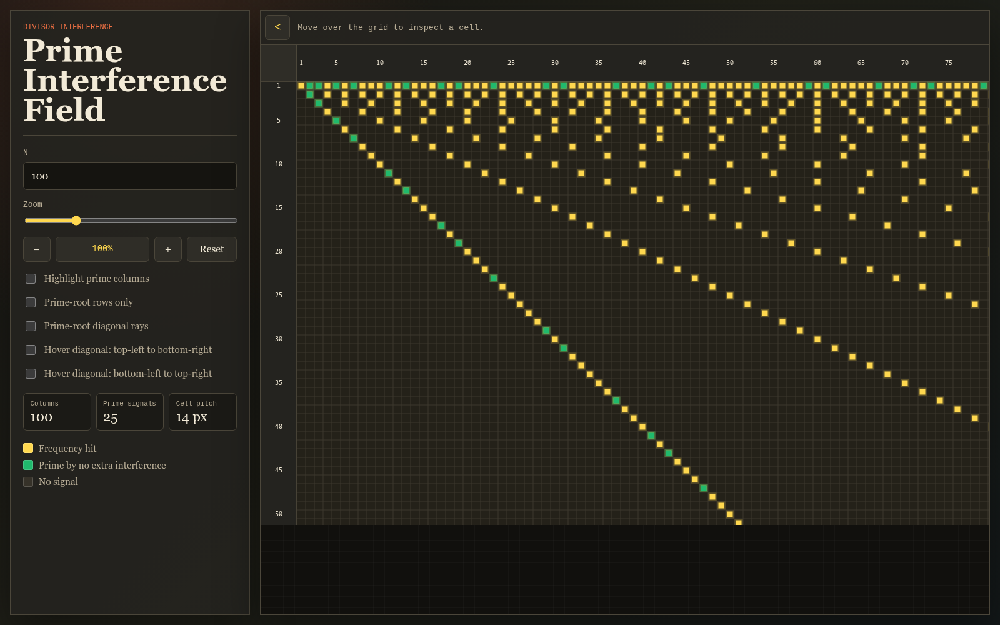

# Prime Interference Field

An interactive visualization of divisibility and prime numbers, built with plain HTML, CSS, JavaScript, and Canvas.

Each row represents a divisor and each column represents an integer. A cell lights up when its column is divisible by its row. Prime numbers have exactly two such hits—at row 1 and at their own row—and appear in green; other divisor hits appear in yellow.



## Run locally

With Python 3 installed, run this command from the project directory:

```sh
python3 -m http.server 4173
```

Open [localhost:4173](http://localhost:4173) in your browser. If Node.js and npm are installed, `npm start` runs the same server. No dependency installation or build step is required.

## Explore the grid

- Set **N** from 2 to 5,000 to change the grid size (default: 100).
- Zoom from 40% to 300% and scroll to explore larger grids.
- Enable **Highlight prime columns** to color each prime column from row 1 through its diagonal cell.
- Toggle **Prime-root rows only** and **Prime-root diagonal rays** to explore different signal patterns.
- Hover over a cell to inspect it; enable either hover diagonal to trace it across the grid.
- Collapse the controls with the arrow above the grid for more viewing space.

## Tests

With Node.js and npm installed:

```sh
npm test
```

The tests use Node's built-in test runner to check divisibility, prime detection, visualization filters, hover behavior, and canvas layout.
